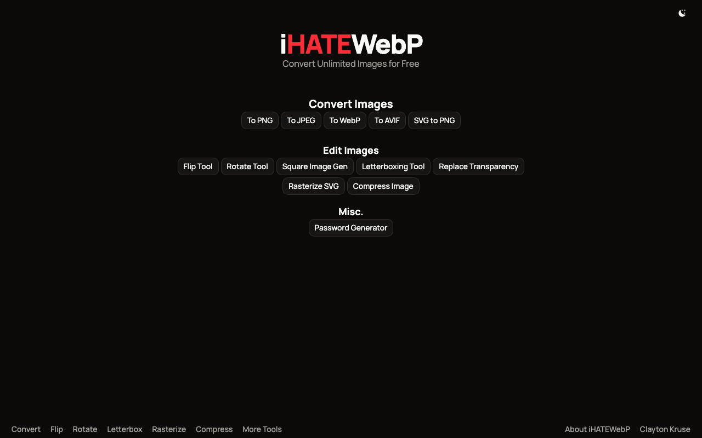
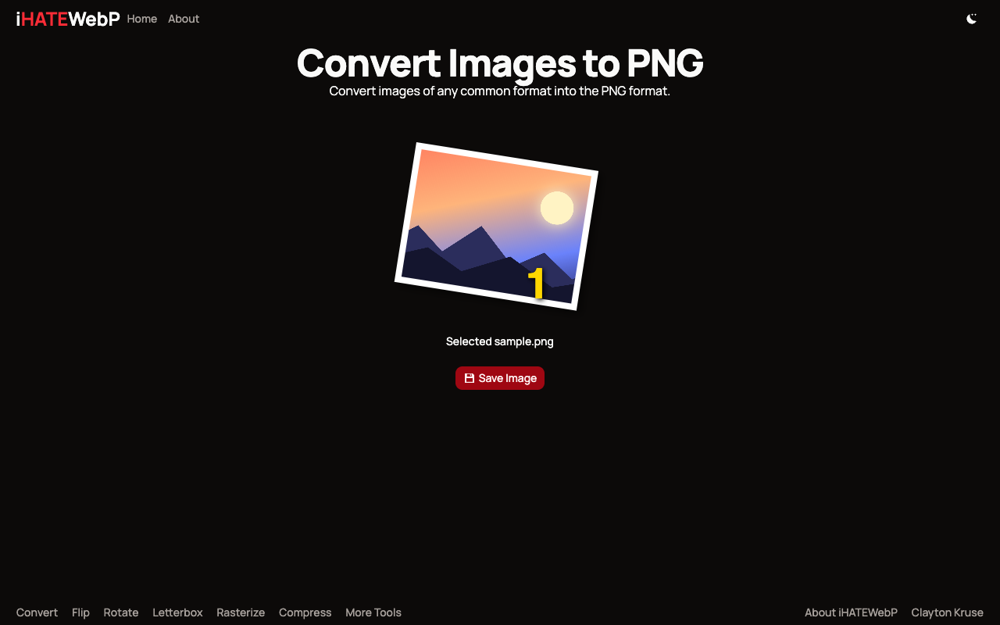
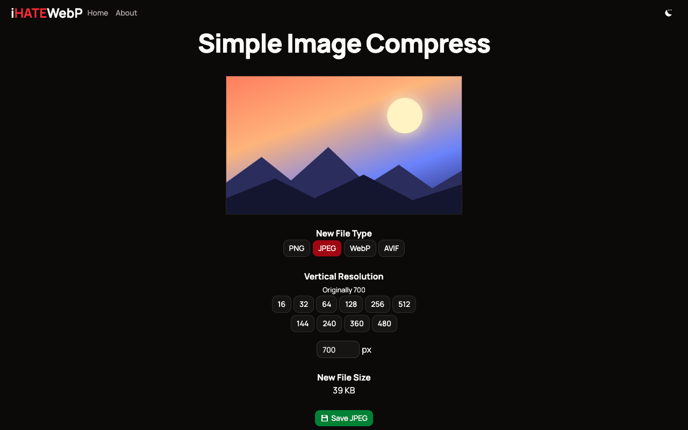
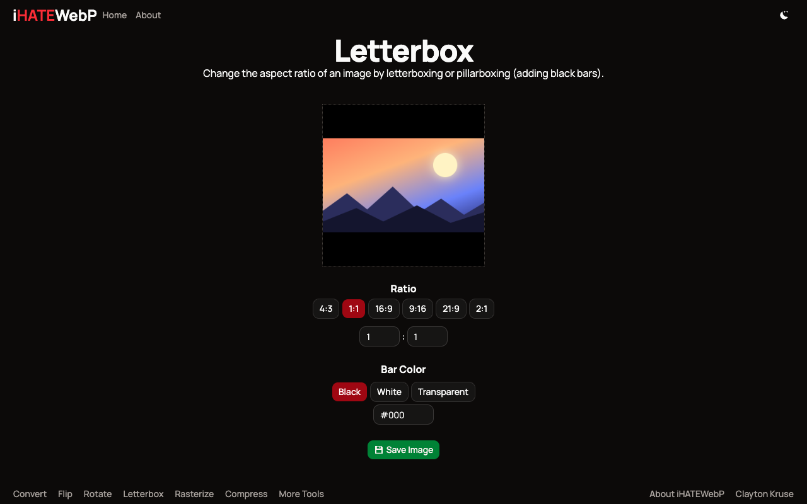
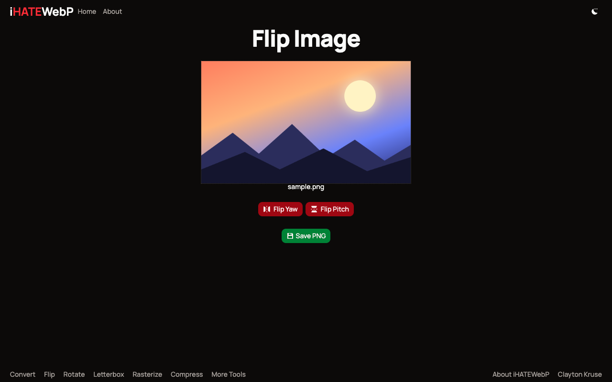
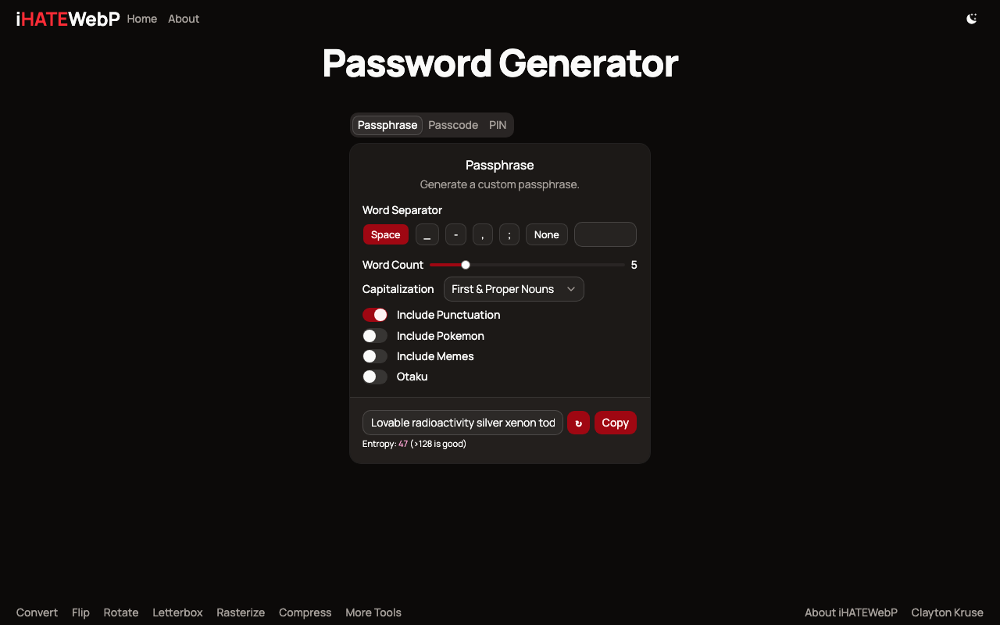

# iHATEWebP

**A free, private, in-browser toolbox for everyday image chores.** Live at [ihatewebp.com](https://ihatewebp.com/).

Ever downloaded an image only to find it's a `.webp` that your software refuses to open? iHATEWebP converts it (and does a handful of other small image jobs) right in your browser. There are no uploads, accounts, watermarks, or limits.

> **Do you really hate WebP?** Not at all. WebP compresses far better than PNG. The name comes from how many people say "I hate WebP" when their software won't open it.

<p align="center">
  <a href="https://ihatewebp.com/"></a>
</p>

---

## Table of Contents

- [Screenshots](#screenshots)
- [Features](#features)
- [Privacy](#privacy)
- [Tech Stack](#tech-stack)
- [Getting Started](#getting-started)
- [Scripts](#scripts)
- [Project Structure](#project-structure)
- [How It Works](#how-it-works)
- [Adding a Conversion Format](#adding-a-conversion-format)
- [Deployment](#deployment)
- [Roadmap](#roadmap)

---

## Screenshots

<table>
  <tr>
    <td width="50%"><a href="https://ihatewebp.com/convert/png/"></a><br><b>Convert</b>: drop in any image (or a whole batch) and save it as PNG, JPEG, WebP or AVIF.</td>
    <td width="50%"><a href="https://ihatewebp.com/compress/"></a><br><b>Compress</b>: choose an output format and resolution, and watch the new file size update live.</td>
  </tr>
  <tr>
    <td width="50%"><a href="https://ihatewebp.com/letterbox/?w=1&h=1"></a><br><b>Letterbox</b>: pad an image to any aspect ratio with black, white, transparent or custom-colored bars.</td>
    <td width="50%"><a href="https://ihatewebp.com/flip/"></a><br><b>Flip</b>: mirror an image horizontally or vertically.</td>
  </tr>
  <tr>
    <td width="50%"><a href="https://ihatewebp.com/password-generator/"></a><br><b>Password Generator</b>: passphrases, passcodes and PINs from <code>crypto.getRandomValues</code>.</td>
    <td width="50%"></td>
  </tr>
</table>

---

## Features

### Convert Images

| Route                                     | Description                                                                                                                               |
| ----------------------------------------- | ----------------------------------------------------------------------------------------------------------------------------------------- |
| [`/convert/png/`](https://ihatewebp.com/convert/png/)   | Convert any browser-readable image to PNG                                                                                     |
| [`/convert/jpeg/`](https://ihatewebp.com/convert/jpeg/) | Convert to JPEG (`/convert/jpg/` and `/convert/jpe/` redirect here)                                                           |
| [`/convert/webp/`](https://ihatewebp.com/convert/webp/) | Convert to WebP 😭                                                                                                            |
| [`/convert/avif/`](https://ihatewebp.com/convert/avif/) | Convert to AVIF (depends on the browser's encoder support)                                                                   |

All converters support **bulk conversion**: select many files at once and get a progress bar while they convert. You can download each file on its own or as a single **ZIP archive** (built with [`@zip.js/zip.js`](https://gildas-lormeau.github.io/zip.js/)). The app remembers which download mode you prefer.

### Edit Images

| Tool                     | Route                    | What it does                                                                                               |
| ------------------------ | ------------------------ | ---------------------------------------------------------------------------------------------------------- |
| **Flip**                 | `/flip/`                 | Mirror an image horizontally or vertically                                                                 |
| **Rotate**               | `/rotate/`               | Rotate in 90° steps                                                                                        |
| **Letterbox**            | `/letterbox/`            | Pad an image to any aspect ratio with a background color. Accepts `?w=` and `?h=` query params (e.g. `/letterbox/?w=16&h=9`) |
| **Square Image Gen**     | `/letterbox/?w=1&h=1`    | The letterbox tool preset to 1:1                                                                           |
| **Replace Transparency** | `/replace-transparency/` | Flatten transparent areas onto a solid background color and export as JPEG                                |
| **Rasterize SVG**        | `/rasterize/`            | Render an `.svg` to a PNG at the resolution you choose                                                     |
| **Compress**             | `/compress/`             | Downscale and re-encode an image (PNG / JPEG / WebP) with a live file-size readout                         |

### Misc.

| Tool                   | Route                  | What it does                                                                                                                                                                                         |
| ---------------------- | ---------------------- | ---------------------------------------------------------------------------------------------------------------------------------------------------------------------------------------------------- |
| **Password Generator** | `/password-generator/` | Three modes: **Passphrase** (random words from a curated list, with capitalization, separator and punctuation options and an entropy estimate), **Passcode** (random characters from configurable sets, with rejection sampling to avoid modulo bias) and **PIN** (4–10 digits). All randomness comes from `crypto.getRandomValues`. |

### Quality-of-Life

- **Drag & drop** or **paste from clipboard** (Ctrl/Cmd+V) into any file selector
- Image previews in the file selector
- Light/dark mode via [`mode-watcher`](https://github.com/svecosystem/mode-watcher)
- **Offline support:** a service worker caches the app, so it keeps working after the first visit
- Fully prerendered static site with SEO-friendly per-tool pages

---

## Privacy

**Your files never leave your device.** Every tool runs on the HTML `<canvas>` API (plus `FileReader`, `Blob` and Web Crypto) inside your browser. The site has no backend, so it has nowhere to upload to.

---

## Tech Stack

- **Framework:** [SvelteKit](https://svelte.dev/docs/kit) + [Svelte 5](https://svelte.dev/) (runes)
- **Adapter:** [`@sveltejs/adapter-static`](https://svelte.dev/docs/kit/adapter-static), fully prerendered
- **Build tool:** [Vite](https://vite.dev/)
- **Language:** TypeScript
- **Styling:** [Tailwind CSS v4](https://tailwindcss.com/) via `@tailwindcss/vite`
- **UI components:** [shadcn-svelte](https://shadcn-svelte.com/) on top of [Bits UI](https://bits-ui.com/)
- **Icons:** [Lucide](https://lucide.dev/) and [unplugin-icons](https://github.com/unplugin/unplugin-icons) (Iconify)
- **Fonts:** Inter, Manrope and JetBrains Mono via Fontsource
- **ZIP archives:** [`@zip.js/zip.js`](https://github.com/gildas-lormeau/zip.js)
- **Package manager:** [pnpm](https://pnpm.io/)

---

## Getting Started

### Prerequisites

- [Node.js](https://nodejs.org/) (a current LTS release)
- [pnpm](https://pnpm.io/installation). The version is pinned in `package.json` under `packageManager`, so running `corepack enable` picks it up automatically.

### Install & Run

```sh
git clone https://github.com/claytonkruse/toolbox.git ihatewebp
cd ihatewebp
pnpm install
pnpm dev
```

The dev server starts at <http://localhost:5173>. Add `-- --open` to open it in your browser automatically.

---

## Scripts

| Command            | Description                                              |
| ------------------ | -------------------------------------------------------- |
| `pnpm dev`         | Start the Vite dev server with HMR                       |
| `pnpm build`       | Prerender the whole site to static files in `build/`     |
| `pnpm preview`     | Serve the production build locally                       |
| `pnpm check`       | Type-check the project with `svelte-check`               |
| `pnpm check:watch` | Type-check in watch mode                                 |
| `pnpm format`      | Format everything with Prettier                          |
| `pnpm lint`        | Check formatting with Prettier and lint with ESLint      |

The project has no automated test suite yet. Use `pnpm check` and `pnpm lint` before committing.

---

## Project Structure

```
.
├── src/
│   ├── app.html                  # HTML shell
│   ├── app.css                   # Tailwind + theme tokens
│   ├── service-worker.js         # Offline caching of build + static assets
│   ├── lib/
│   │   ├── imageUtils.ts         # Canvas helpers: load, flip, rotate, scale, flatten, save
│   │   ├── icons.ts              # Shared icon exports
│   │   ├── utils.ts              # `cn()` class-merging helper (shadcn)
│   │   └── components/
│   │       ├── FileSelector.svelte       # Click / drag-drop / paste file input with previews
│   │       ├── ImagePreview.svelte
│   │       ├── ResolutionSelector.svelte
│   │       ├── SaveButton.svelte
│   │       ├── Footer.svelte
│   │       └── ui/                       # shadcn-svelte generated components
│   └── routes/
│       ├── +layout.svelte / +layout.ts   # Global layout; prerender + trailing slashes
│       ├── +page.svelte                  # Home page / tool index
│       ├── about/                        # FAQ
│       ├── convert/
│       │   ├── formats.ts                # Supported output formats + aliases
│       │   └── [format]/                 # Dynamic, prerendered converter pages
│       ├── compress/
│       ├── flip/
│       ├── rotate/
│       ├── letterbox/
│       ├── rasterize/
│       ├── replace-transparency/
│       ├── password-generator/           # Passphrase, Passcode & PIN generators + words.txt
│       └── zip/                          # Work in progress (not linked yet)
├── static/                       # Favicons & web manifest
├── components.json               # shadcn-svelte config
├── svelte.config.js
└── vite.config.ts
```

---

## How It Works

Every image tool follows the same pattern, built on the helpers in [`src/lib/imageUtils.ts`](src/lib/imageUtils.ts):

1. **Read** the selected `File` into a data URL with `FileReader`.
2. **Decode** it into an `HTMLImageElement`.
3. **Draw** it onto an off-screen `<canvas>`, applying the transform (flip, rotate, scale, background fill, etc.).
4. **Encode** the result with `canvas.toDataURL('image/<format>')`.
5. **Save** it by clicking a temporary `<a download>` element.

Because encoding goes through `canvas.toDataURL`, the output formats available depend on the browser. Every browser supports PNG and JPEG. WebP and AVIF encoding vary by browser, and a browser that can't encode the requested format falls back to PNG.

The whole site is prerendered (`export const prerender = true`) with trailing slashes. The `/convert/[format]/` pages are generated from `formats.ts` through an `entries()` generator, and alias routes such as `/convert/jpg/` issue a `301` redirect to their canonical page.

---

## Adding a Conversion Format

1. Add an entry to [`src/routes/convert/formats.ts`](src/routes/convert/formats.ts):

   ```ts
   {
   	name: 'GIF',           // display name; lowercased for the URL and MIME type
   	aliases: ['GIFF'],     // optional; these redirect to the canonical route
   	ext: 'gif'             // optional; file extension (defaults to name.toLowerCase())
   }
   ```

2. Optionally add a button for it on the home page (`src/routes/+page.svelte`).

The route is prerendered automatically at build time.

---

## Deployment

`pnpm build` writes a plain static site to `build/`. Any static host can serve it: Netlify, Vercel, Cloudflare Pages, GitHub Pages, S3, nginx, and so on.

```sh
pnpm build
pnpm preview   # sanity-check the build locally
```

---

## Roadmap

- [x] Bulk download archive option
- [x] Progress bars for bulk actions
- [x] Paste images from clipboard
- [x] Image rotator (90° increments)
- [x] Aspect ratio tool (letterboxing)
- [x] Remove transparency (JPEG converter with background color selector)
- [x] SVG rasterizer
- [x] Image compressor
- [x] File selector image previews
- [x] Flip image tool
- [x] Password / passphrase / PIN generator
- [ ] Image caption adder
  - [ ] Polaroid style
- [ ] Image rounder
  - [ ] Squircle / superellipse (maybe also as an SVG rasterizer option)
  - [ ] Regular rounded corners
  - [ ] Circle
- [ ] Only create selection preview when requested via a prop
- [ ] File zipper (for people who can't install 7-Zip on their hardware)
- [ ] File unzipper
- [ ] Automatically copy final image to clipboard
- [ ] Reimplement `imageUtils` as a class
- [ ] Offline use
  - [x] Service worker
  - [ ] Downloadable version (Ctrl+S saveable?)
- [ ] Website icon maker
- [ ] Video compressor
- [ ] Image metadata viewer
- [ ] Image metadata remover

---

Made by [Clayton Kruse](https://claytonkruse.com/).
